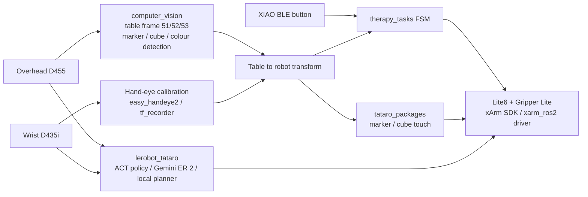

# TATARO Firmware V1.0

TATARO is a robot-assisted **upper-limb rehabilitation** workstation built around a **UFactory Lite6** arm.
The robot presents an object at set positions around the patient, and the patient reaches out and presses a
button (the **grid-based progressive reaching therapy**). The same platform is also used to develop
**vision-guided manipulation**: touching ArUco markers, tracking cubes, and **picking a coloured cube and
dropping it into a bowl**. The pick-and-place work uses three approaches: a classical vision pipeline, a
policy learned from demonstrations (LeRobot ACT), and Gemini Robotics-ER 2.

This repository contains the full ROS 2 workspace, the UFactory Python SDK, and the LeRobot code used on the
real robot.

---

## Contents

1. [Hardware](#1-hardware)
2. [Repository layout](#2-repository-layout)
3. [System overview](#3-system-overview)
4. [Installation](#4-installation)
5. [Tasks](#5-tasks)
   - 5.1 [Grid-based progressive reaching therapy](#51-grid-based-progressive-reaching-therapy)
   - 5.2 [Marker 40 detect and touch](#52-marker-40-detect-and-touch)
   - 5.3 [Cube tracking and touch](#53-cube-tracking-and-touch)
   - 5.4 [Colour-cube detection and hover test](#54-colour-cube-detection-and-hover-test)
   - 5.5 [Pick-and-place with a learned policy (LeRobot ACT)](#55-pick-and-place-with-a-learned-policy-lerobot-act)
   - 5.6 [Pick-and-place with Gemini Robotics-ER 2 or the local planner](#56-pick-and-place-with-gemini-robotics-er-2-or-the-local-planner)
   - 5.7 [Teleoperation](#57-teleoperation)
6. [Calibration](#6-calibration)
7. [Simulation](#7-simulation)
8. [Validation and analysis](#8-validation-and-analysis)
9. [Coordinate frames and conventions](#9-coordinate-frames-and-conventions)
10. [Troubleshooting](#10-troubleshooting)
11. [Project status](#11-project-status)
12. [Third-party code and licences](#12-third-party-code-and-licences)

---

## 1. Hardware

| Component | Model | Role |
|---|---|---|
| Robot arm | UFactory **Lite6** (6-DOF, 440 mm reach), controller IP `192.168.1.150` | Presents objects (therapy) and does manipulation |
| Gripper | UFactory **Gripper Lite** (parallel, 40 mm max opening, open/close only, no width feedback) | Holds the therapy object; grasps 30 mm cubes |
| Overhead camera | Intel RealSense **D455**, fixed above the table | Table frame, object detection, overhead view for learned policies |
| Wrist camera | Intel RealSense **D435i** on a stand beside the gripper (eye-in-hand) | Hand-eye calibration, close-up view for grasping |
| Patient button | Seeed **XIAO nRF52840** BLE push-button (`xiao-tataro-task1`) | The patient confirms each reach by pressing it |
| Table | Work surface with ArUco **DICT_7X7** markers **52** (top-left), **51** (top-right), **53** (bottom-right) | Defines the table frame |
| Objects | 3 cm coloured cubes (red/green/blue), 3.5 cm ArUco cube (DICT_4X4 ID 1), Marker 40, bowl | Targets for the vision and manipulation tasks |
| PC | Ubuntu 22.04, ROS 2 Humble, NVIDIA RTX 4060 (8 GB) | Runs everything above |

The camera mount is modelled in the TATARO changes to `xarm_ros2/xarm_description`
(`realsense_d435i.urdf.xacro`, `xarm_device*.xacro`).

---

## 2. Repository layout

```
TATARO_FirmwareV1.0/
├── xarm_ros2/                       ROS 2 Humble workspace (UFactory xarm_ros2 + TATARO packages)
│   ├── src/
│   │   ├── therapy_tasks/           ★ Grid-based progressive reaching therapy (FSM, button, levels YAML)
│   │   ├── tataro_packages/         ★ TATARO runtime launches, marker/cube touch, GUIs, teleop, Gemini nodes
│   │   ├── computer_vision/         ★ Table frame, marker/cube/colour detection, HSV picker, GG-CNN
│   │   ├── sensors/                 ★ XIAO BLE button reader + Arduino firmware
│   │   ├── tf_recorder/             ★ Hand-eye data capture, pose and trajectory replay
│   │   ├── tatro_handeye_sim/       ★ Gazebo hand-eye calibration simulation
│   │   ├── tataro_gazebo_environment/ ★ Gazebo model of the TATARO workstation (+ MoveIt)
│   │   ├── realsense2_ros_mqtt_bridge/  RealSense ROS <-> MQTT bridge
│   │   └── aruco_ros/, easy_handeye2/, easy_handeye2_msgs/, realsense2_*   third-party
│   ├── xarm_description/            UFactory URDFs (+ TATARO camera-mount changes)
│   ├── xarm_api, xarm_controller, xarm_moveit_config, xarm_gazebo, ...     UFactory packages
│   ├── Calibration/                 ★ Hand-eye calibration results (*.calib) from every session
│   ├── MOCAP_Validation/            ★ Motion-capture validation of the camera/table transforms
│   ├── Issac_Sim/                   ★ Isaac Sim recording batches
│   └── Claude_files/                ★ Design notes and guides written during development
├── xArm-Python-SDK/                 UFactory Python SDK
│   └── lite6_calibration_pooja/     ★ SDK-only eye-in-hand calibration (affine fit)
└── lerobot_tataro/                  ★ LeRobot integration (learned pick-and-place)
    ├── lerobot_robot_lite6/         --robot.type=lite6 plugin (Cartesian control, cameras, gripper)
    ├── scripts/                     record / train / evaluate / run policies, Gemini pick, dataset tools
    ├── sim/                         MuJoCo scene calibrated against the real cameras
    └── README.md                    full LeRobot workflow
```

★ = written for TATARO. Everything else is upstream code. The datasets are in a separate repository,
[TATARO_LeRobot_Dataset](https://github.com/Pooja15V/TATARO_LeRobot_Dataset); clone it into
`lerobot_tataro/datasets/`.

---

## 3. System overview



- **Perception.** At start-up the overhead D455 finds table markers 51/52/53 once and locks the
  **table frame**. A fixed, measured table -> robot transform turns any detection on the table into robot
  base coordinates. The wrist D435i is related to the robot flange by an eye-in-hand calibration.
- **Control.** Most task scripts drive the arm directly through the **xArm Python SDK**
  (`XArmAPI`, position mode). The ROS 2 driver / MoveIt are used for visualisation, TF, and calibration.
- **Patient interaction.** The BLE button publishes `/tataro/button_pressed`, and the therapy FSM counts
  repetitions from it.

---

## 4. Installation

### 4.1 ROS 2 workspace

```bash
sudo apt install ros-humble-desktop python3-colcon-common-extensions python3-rosdep
cd xarm_ros2
source /opt/ros/humble/setup.bash
rosdep install --from-paths src --ignore-src -y
colcon build --symlink-install
source install/setup.bash
```

Upstream `xarm_ros2` normally pulls `xarm_sdk/cxx` as a git submodule; here it is included as plain files.
To rebuild only the TATARO packages after editing them:

```bash
colcon build --packages-select tataro_packages therapy_tasks tf_recorder --symlink-install
```

### 4.2 Python dependencies (outside ROS)

```bash
pip install ./xArm-Python-SDK                        # XArmAPI
pip install opencv-contrib-python pyrealsense2 numpy scipy bleak pynput
```

### 4.3 LeRobot environment (learned policies)

```bash
conda create -n lerobot python=3.12 && conda activate lerobot
# install LeRobot from source (https://github.com/huggingface/lerobot), then:
pip install -e lerobot_tataro/lerobot_robot_lite6
pip install google-genai                              # only for the Gemini scripts
```

Clear ROS's `PYTHONPATH` when running LeRobot scripts (`PYTHONPATH= python ...`). Otherwise the ROS Humble
Python 3.10 packages clash with Python 3.12.

### 4.4 Network

The PC and the Lite6 controller must be on the same subnet (`192.168.1.x`). Check the connection with
`ping 192.168.1.150`.

---

## 5. Tasks

### 5.1 Grid-based progressive reaching therapy

Package: `xarm_ros2/src/therapy_tasks`. Configuration: `config/tataro_therapy_levels.yaml`.

**The idea.** The robot holds an object out in front of the patient at a series of target positions. The
patient reaches towards it and presses the BLE button. After a set number of successful repetitions, the
session moves on to the next, harder **level**. Each level is either one fixed pose or a **grid** of poses.
For a grid level, every repetition presents a different grid point, drawn at random **without repeats**
(a "shuffle bag") until all points have been used. This varies the reach from trial to trial without
changing the overall difficulty.

**Level 1: full lateral/vertical reach envelope** (verified on the real robot). This is a 3 x 3 grid in the
plane x = 440 mm in front of the robot, with the gripper pointing forward (roll 0.1°, pitch −83°,
yaw −179.8°):

| | y = −240 mm | y = 0 | y = +240 mm |
|---|---|---|---|
| **z = 400 mm** | P7 | P8 | P9 |
| **z = 197.3 mm** | P4 | P5 (centre) | P6 |
| **z = 100 mm** | P1 | P2 | P3 |

Levels 2–6 are placeholders (`calibrated: false`) and are **blocked** until they are measured on the robot.

**State machine** (`fsm_node.py`):

```
INIT_TABLE -> GRASP_OBJECT -> MOVE_TO_LEVEL <-> WAIT_FOR_BUTTON -> ADVANCE_LEVEL -> ... -> SESSION_COMPLETE
```

| State | What happens |
|---|---|
| `INIT_TABLE` | Checks that table markers 51/52/53 are visible, then connects to the arm |
| `GRASP_OBJECT` | Moves to the object-holder pose, closes the gripper and lifts (slow, 60 mm/s) |
| `MOVE_TO_LEVEL` | Presents the held object at this repetition's target. Moves at a hover height first, then in XY (200 mm/s) |
| `WAIT_FOR_BUTTON` | Holds still until a Released -> Pressed edge on `/tataro/button_pressed`. Each edge counts as one repetition |
| `ADVANCE_LEVEL` | After `reps_per_level` (default **10**) repetitions, moves on to the next level |
| `SESSION_COMPLETE` | Holds the final pose, or restarts from level 1 (`session.on_complete`) |

**Safety: per-pose calibration gate.** Every pose in the YAML has a `calibrated` flag. The FSM **refuses**
to move to a pose whose flag is `false`. To enable a new pose:

1. Jog the robot there (for example with `TATRO_PositionControl_GUI.py`).
2. Check that the pose is reachable, collision-free and clinically appropriate.
3. Copy the live `arm.get_position()` reading into the YAML.
4. Only then set `calibrated: true`.

All motions also go through a workspace bounds check (`therapy_tasks/motion.py`).

**Running it**

```bash
# Full session: D455 + xArm driver + BLE button + FSM
ros2 launch therapy_tasks tataro_therapy_session.launch.py

# Bench test without the BLE board: press 'n' instead of the button.
# Run it in its own terminal and comment out the BLE node in the launch file.
ros2 run therapy_tasks tataro_keyboard_button_monitor

# Diagnostics (no grasp; check the grid and the button wiring)
ros2 run therapy_tasks tataro_level1_grid_test                                # next grid point on every press
ros2 run therapy_tasks tataro_level1_grid_test --ros-args -p center_only:=true  # only the verified centre pose
ros2 run therapy_tasks tataro_button_move_test                                # small Z nudge per press
ros2 run therapy_tasks tataro_grasp_lift_test                                 # grasp + lift only
ros2 run therapy_tasks tataro_button_monitor                                  # BLE button -> /tataro/button_pressed
```

**Module split.** Perception (`perception.py`), motion (`motion.py`), target selection (`grid_select.py`,
shared by the FSM and the diagnostics) and the button (`button_monitor.py`) are separate on purpose. The FSM
only sequences them. Therapists can retune poses, repetitions, speeds and gripper timings in the YAML
without touching code.

**The button** (`xarm_ros2/src/sensors`). The XIAO firmware (the Arduino sketch is in `connect_xiao.py`)
notifies `PRESSED` / `RELEASED` on a BLE characteristic. Older firmware only sends a `GREEN` status, and the
monitor treats that as a press. `read_button_ble.py` is a standalone reader for testing.

### 5.2 Marker 40 detect and touch

The robot touches the centre of ArUco **Marker 40** (anywhere on the table) with a calibration pin. This is
the end-to-end test of the camera -> table -> robot transform chain.

```bash
ros2 launch tataro_packages tataro_cv_detect_touch_marker_loop.launch.py   # D455 + CV pipeline + xArm driver
cd xarm_ros2/src/tataro_packages
python3 tataro_marker40_touch_loopV1.0.py     # locks the table, tracks Marker 40, hovers then touches,
                                              # follows the marker when it moves
```

- `tataro_marker40_touch.py` runs a single touch.
- `tataro_marker40_touch_loop.py` touches on Enter.
- Detection: `computer_vision/TATARO_CV_PipelineV1.0.py` (table frame from 51/52/53 via Gram-Schmidt in
  `TATARO_CV_GSO.py`, then the table -> robot transform in `TATARO_CV_Transformations.py`).

### 5.3 Cube tracking and touch

This tracks a 3.5 cm cube with a DICT_4X4 ID-1 marker on each face, and touches its centre.

```bash
ros2 launch tataro_packages tataro_cv_detect_object_loop.launch.py robot_ip:=192.168.1.150
cd xarm_ros2/src/tataro_packages && python3 object_touch.py
```

### 5.4 Colour-cube detection and hover test

`computer_vision/TATARO_CV_ObjectDetectionPipeline.py` finds plain red/green/blue cubes (no markers) by HSV
colour inside the table mask. It locks onto one cube and gives a grasp pose for the parallel gripper,
including the yaw that aligns the fingers with the cube faces.

- `TATARO_CV_HSVPicker.py`: keyboard crosshair tool to calibrate the HSV ranges for your lighting
  (WASD to move, SPACE to sample).
- `tataro_packages/tataro_cube_hover_test.py`: hovers above the detected cube **without** using the gripper.
- `TATARO_CV_GGCNNDetection.py` / `TATARO_CV_GGCNNViewer.py`: experimental GG-CNN grasp-point detection for
  arbitrary objects (view only; not trusted near the arm yet).

### 5.5 Pick-and-place with a learned policy (LeRobot ACT)

Folder: `lerobot_tataro/` (full guide in [`lerobot_tataro/README.md`](lerobot_tataro/README.md)).
Task: *"Pick up the green cube and place it in the bin."*

1. **Robot plugin.** `--robot.type=lite6` gives LeRobot Cartesian control of the Lite6 (TCP x, y, z,
   rotation, gripper), the two RealSense cameras, and safety limits (`config_lite6.py`).
2. **Record demonstrations.**
   - `scripts/record_handguided.py`: hand-guided grasps.
   - `scripts/place_cube.py`: shows where to put the cube on a grid in a zone.
   - Android phone teleop is also available.
3. **Synthetic data.** `scripts/recolor_dataset.py` recolours blue-cube episodes to red and green. This adds
   colour variety but **not** new positions.
4. **Train / validate.**
   - `split_train_val.py` keeps every real episode in the same split as its recoloured copies.
   - Train with `lerobot-train` (ACT).
5. **Evaluate offline.** `scripts/eval_offline.py` replays held-out episodes through the policy and reports
   the TCP error. `--live` streams the cameras, predicted vs recorded actions, and both 3D TCP paths to a
   Rerun viewer.
6. **Run on the arm.** `scripts/run_policy.py --ckpt ... --task "..."`.

### 5.6 Pick-and-place with Gemini Robotics-ER 2 or the local planner

`lerobot_tataro/scripts/gemini_pick.py` combines a high-level planner with precise geometry and scripted
motion:

```
get_overhead_image -> move_above(cube) -> wrist image -> grasp_and_lift(cube, angle) -> place_in_bowl -> go_home -> verify
```

- **Planner.**
  - Default: **Gemini Robotics-ER 2** (`gemini-robotics-er-2-preview`, cloud API). It points at the cube in
    the images and calls the five functions above. Its system prompt is `scripts/gemini_system_prompt.txt`.
  - `--local`: the same skills with a fixed planner and colour detection. No API needed.
- **Geometry.**
  - The overhead pixel is mapped through the table warp and a homography to robot mm, with bias correction.
  - The wrist camera gives the cube yaw and an independent position cross-check.
  - Grasp yaw aligns the finger closing axis with a cube edge.
- **Success check.** Success is only reported if the bowl region of the overhead image has changed.
- **Options.** `--dry-run EP` replays a recorded episode without moving the arm. `--no-confirm`, speeds and
  heights are all command-line options.
- The API key is read from the `GEMINI_API_KEY` environment variable only.

Earlier ROS 2 experiments with Gemini are in `tataro_packages/launch/tataro_gemini_manipulator_node.py` and
`tataro_packages/launch/gemini_er2/tataro_gemini_eyeinhand_calibration_node.py`.

### 5.7 Teleoperation

| Tool | How |
|---|---|
| `tataro_packages/TATRO_PositionControl_GUI.py` | Desktop GUI to jog the TCP (used to measure the therapy poses) |
| `tataro_packages/teleop_lite6.py` | Phone/VR WebXR teleop (adapted from SpesRobotics/teleop). Open the printed `https://<pc-ip>:4443` on the phone |
| `lerobot_tataro` phone teleop | Android phone teleop for recording LeRobot datasets |

---

## 6. Calibration

| What | Tools | Output |
|---|---|---|
| **Eye-in-hand (wrist D435i -> flange)** | `easy_handeye2` with a ChArUco board or single ArUco marker. `tf_recorder` captures poses (`tf_pose_capture.py`, `automate_calibration_poses.py`, `traj_replay*.py`) | `xarm_ros2/Calibration/tataro_handeye_*.calib` (one file per session; `11A` = ChArUco) |
| **Table frame (overhead D455 -> table -> robot)** | Markers 51/52/53, `TATARO_CV_GSO.py`, `TATARO_CV_Transformations.py`, `TATARO_CV_OverheadTBaseCam.py` | Table -> robot transform constants |
| **Calibration check** | `tatro_runtime_calibrationcheck.launch.py` (table crop view + 7x7 marker TF + pin touch), `tataro_calibration_diagnostic.py` | Measured touch error |
| **SDK-only calibration** | `xArm-Python-SDK/lite6_calibration_pooja/` (collect points -> affine fit -> test) | `calibration_data.pkl` |

Example hand-eye session:

```bash
ros2 launch realsense2_camera rs_launch.py tf_publish_rate:=0.0 enable_sync:=true align_depth.enable:=true
ros2 launch aruco_ros charuco_detector.launch.py
ros2 launch xarm_moveit_config lite6_moveit_realmove.launch.py robot_ip:=192.168.1.150 \
     add_gripper:=true add_realsense_d435i:=true add_d435i_links:=false
ros2 launch easy_handeye2 calibrate.launch.py name:=tataro_handeye_11 calibration_type:=eye_in_hand \
     robot_base_frame:=link_base robot_effector_frame:=link_eef \
     tracking_base_frame:=camera_color_optical_frame tracking_marker_frame:=charuco_board_frame

# then run the system with that calibration
ros2 launch tataro_packages tatro_runtimeV1.0.launch.py robot_ip:=192.168.1.150 calib_name:=tataro_handeye_11A
```

---

## 7. Simulation

| Simulator | Where | What |
|---|---|---|
| **Gazebo** | `tataro_gazebo_environment` | TATARO workstation world (table, mounting plate, markers) + Lite6 + gripper + D435i, MoveIt planning scene, marker spawner, touch controller. `ros2 launch tataro_gazebo_environment tataro_with_moveit.launch.py` |
| **Gazebo** | `tatro_handeye_sim` | Full eye-in-hand calibration rehearsal (Gazebo + MoveIt + ArUco + EasyHandEye2). `ros2 launch tatro_handeye_sim tatro_gazebo_calibration.launch.py` |
| **Gazebo** | `tataro_packages/launch/tatro_runtime_simulation.launch.py` + `fake_aruco_publisher.py` | Marker touch in simulation, no camera |
| **MuJoCo** | `lerobot_tataro/sim/` | Scene whose overhead and wrist cameras are fitted to the real ones. `compare_sim_demos.py` overlays every real demo's cube position on the sim and real views, and plots original vs synthetic episodes (`sim_vs_demos.png`) |
| **Isaac Sim** | `xarm_ros2/Issac_Sim/recording_batches` | Recorded simulation batches (parquet) from the Isaac Sim / ROS 2 experiments |

---

## 8. Validation and analysis

- **`MOCAP_Validation/`**: motion-capture validation of the camera -> table-marker -> robot chain. Includes
  synchronised loggers (`sync_marker_charuco_*_logger.py`, `syncpulse_reader.py`), trial recordings, and
  notebooks (`TransformationValidation*.ipynb`, `ChArUcoDriftAnalysis03.ipynb`) that quantify the transform
  accuracy and the ChArUco drift.
- **`lerobot_tataro/scripts/eval_offline.py`**: offline policy evaluation on held-out (validation)
  episodes. Gives per-episode TCP error, gripper timing accuracy and plots; `--live` opens a Rerun view.
- **`Claude_files/`**: design notes written during development: TF tree and coordinate frames, hand-eye
  calibration review and fixes, Marker 40 touch, Gazebo implementation, quick-start guides.

---

## 9. Coordinate frames and conventions

- **Robot base** `link_base`: x points away from the base towards the table, y to the robot's left, z up,
  in mm (SDK) or m (ROS / LeRobot).
- **TCP.** The flange is `link_eef`; the gripper TCP is `link_tcp`. The LeRobot and Gemini scripts expect
  the controller's TCP z-offset to be **83.6 mm** (fingertip poses) and refuse to run otherwise. Some older
  touch scripts command flange poses and add the pin length themselves; check each script's header.
- **Table frame:** origin and axes from markers 51/52/53 (DICT_7X7). The table -> robot transform is
  measured once.
- **Therapy poses** in the YAML are robot-base `[x, y, z, roll, pitch, yaw]` in mm/deg, read straight
  from `arm.get_position()`.
- **ArUco IDs.** 51/52/53 are the table corners and 40 is the touch target; do not reuse these IDs for
  other markers. ID 1 (DICT_4X4) is the tracked cube.

---

## 10. Troubleshooting

| Symptom | Cause / fix |
|---|---|
| Large ROS 2 image topics drop almost every frame | Raise the FastDDS transport buffer: `export FASTRTPS_DEFAULT_PROFILES_FILE=<profile with bigger buffers>` (kernel `sysctl` alone is not enough) |
| `RealSense: Device or resource busy` | Another process is holding the camera (a previous script, `realsense2_camera`, or a Cyberwave driver container). Stop it first: `sudo pkill -f realsense` |
| Two cameras swapped / intrinsics wrong | Check the serials with `rs-enumerate-devices -s`. The D455 (overhead) has fx ≈ 645 at 1280x720; the D435i (wrist) has fx ≈ 908 |
| OpenCV window is completely black | Use **ASCII-only** window titles (non-ASCII characters such as an em dash break `cv2.imshow` in the C locale) |
| Colour cube not detected | Lighting changed. Re-run `TATARO_CV_HSVPicker.py` and update the HSV ranges |
| Controller error C22 | Self-collision. Avoid the all-zero joint pose |
| Controller error C2 | E-stop pressed. Release it, then clear the error |
| BLE button not advertising | Restart Bluetooth (`sudo systemctl restart bluetooth`) to clear the stale link, then power-cycle the XIAO |
| Gemini `429 RESOURCE_EXHAUSTED` | Free-tier quota for `gemini-robotics-er-2-preview` (20 requests/day). Enable billing or use `--local` |

---

## 11. Project status

| Area | Status |
|---|---|
| Grid-based reaching therapy, Level 1 (3 x 3 grid) | ✅ Poses verified on the real robot. Levels 2–6 still to be defined and calibrated |
| BLE patient button | ✅ Working (PRESSED/RELEASED firmware) |
| Hand-eye + table-frame calibration | ✅ Done (ChArUco); checked with Marker 40 touch, MOCAP recordings in `MOCAP_Validation/` |
| Marker 40 / ArUco cube touch | ✅ Working |
| Colour-cube detection | ✅ Working; HSV ranges must be re-tuned for each lighting setup |
| Scripted pick (`gemini_pick.py`) | ⚠️ Dry runs land 1–4 mm from the demonstrated grasp. One real Gemini run grasped the cube, but placing it in the bowl failed and is being fixed |
| Learned policy (ACT) | ⚠️ Learns *when* to grasp (gripper timing within 0.1 s) but not yet *where*: grasp misses 10–70 mm on validation episodes. Next steps: denser demonstrations, or give the policy the detected cube position |
| Gazebo / MuJoCo simulation | ✅ Scenes built; MuJoCo cameras fitted to the real ones |

---

## 12. Third-party code and licences

| Code | Source | Version here |
|---|---|---|
| `xarm_ros2` | [xArm-Developer/xarm_ros2](https://github.com/xArm-Developer/xarm_ros2), branch `humble` | upstream `d0b9511` + TATARO packages and URDF camera-mount changes |
| `xArm-Python-SDK` | [xArm-Developer/xArm-Python-SDK](https://github.com/xArm-Developer/xArm-Python-SDK) | upstream `a1adbae` + `lite6_calibration_pooja/` |
| `aruco_ros`, `easy_handeye2`, `realsense2_camera` | pal-robotics, marcoesposito1988, IntelRealSense | as vendored in `xarm_ros2/src` |
| `teleop_lite6.py` | adapted from [SpesRobotics/teleop](https://github.com/SpesRobotics/teleop) | |
| GG-CNN | adapted from xArm-Developer/ufactory_vision | |
| LeRobot | [huggingface/lerobot](https://github.com/huggingface/lerobot) (not vendored; install separately) | |

Third-party code keeps its original licence; see the LICENSE files in each folder.
